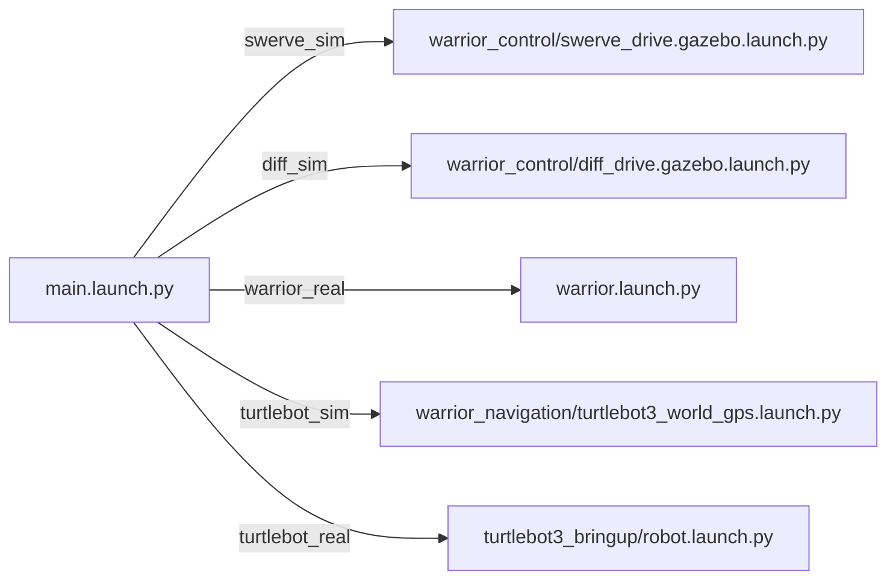
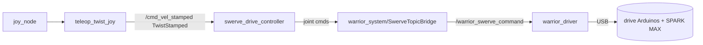

# warrior_bringup

Top-level launchers. Pick a robot type, get a running stack.
See the [workspace README](../README.md) for the whole-system picture.

## Quick Start

Run `pixi run --locked build` once, then enter `pixi shell` before using the
`ros2` commands below. The top-level Pixi tasks cover the common cases directly.

| Goal | Command |
|---|---|
| Manual swerve simulation | `pixi run --locked launch-sim` |
| Autonomous swerve simulation | `pixi run --locked launch-nav-sim` |
| Real swerve teleop | `pixi run --locked launch-real` |
| **Drive real swerve (Xbox)** | `ros2 launch warrior_bringup warrior_swerve_teleop.launch.py` |
| Swerve sim | `ros2 launch warrior_bringup swerve_sim.launch.py` |
| Swerve sim + Nav2 | `ros2 launch warrior_bringup swerve_nav_sim.launch.py` |
| Diff-drive sim | `ros2 launch warrior_bringup diff_sim.launch.py` |
| Real Warrior (ros2_control only) | `ros2 launch warrior_bringup warrior_real.launch.py` |

`--locked` requires the committed `pixi.lock` to remain valid and uses its exact
dependency resolution. This prevents a routine run from silently resolving a
different ROS/Gazebo environment.

## Simulation workflows

### Manual keyboard driving

Start the base simulation:

```bash
pixi run --locked launch-sim
```

Then, in a second terminal in the repository, run:

```bash
pixi run --locked ros2 run teleop_twist_keyboard teleop_twist_keyboard \
  --ros-args -p stamped:=true -p frame_id:=base_footprint \
  -r cmd_vel:=/cmd_vel_stamped
```

Keep that terminal focused and use the keys printed there. Releasing a key does
not itself send a stop, so press `k` (or the space bar) to stop immediately;
the simulation controller also stops a stale keyboard command within 0.75 s.

### Autonomous pose goals

Start the simulation and its odom-relative Nav2 stack:

```bash
pixi run --locked launch-nav-sim
```

RViz intentionally opens only after controller odometry, the `odom` to
`base_footprint` transform, and Nav2's `/navigate_to_pose` action server are
ready. It uses the Warrior Orbit/3D profile with the robot, lidar point cloud,
costmap, and planned path. In the RViz toolbar, select **Nav2 Goal**, click the
target position, and drag the arrow to choose the final heading.

The same goal can be sent from another terminal. This example requests a pose
2 m forward from the robot's startup origin:

```bash
pixi run --locked ros2 action send_goal \
  /navigate_to_pose nav2_msgs/action/NavigateToPose \
  "{pose: {header: {frame_id: odom}, pose: {position: {x: 2.0, y: 0.0, z: 0.0}, orientation: {w: 1.0}}}}" \
  --feedback
```

This simulation profile is deliberately mapless: goals are expressed in
`odom`, relative to the startup pose, and drift is not globally corrected. It
does not require RViz's **2D Pose Estimate** step. Use the GPS/localization
stack for globally referenced field goals.

Do not start keyboard or joystick teleoperation while `launch-nav-sim` is
controlling the robot. There is currently no command-velocity mux/arbitration,
so two publishers would compete for control.

## Launch files

All `*_sim` / `*_real` wrappers just pre-set `robot_type` on `main.launch.py`.

| File | Starts | Sim/Real |
|---|---|---|
| [warrior_swerve_teleop.launch.py](launch/warrior_swerve_teleop.launch.py) | **one-shot real teleop** — RSP, `ros2_control_node` (SwerveTopicBridge HW), joint_state_broadcaster → swerve_drive_controller, `warrior_driver`, joy + teleop_twist_joy | real |
| [main.launch.py](launch/main.launch.py) | dispatcher — branches on `robot_type` (see matrix) | both |
| [swerve_sim.launch.py](launch/swerve_sim.launch.py) | `main` w/ `robot_type:=swerve_sim` | sim |
| [swerve_nav_sim.launch.py](launch_wrappers/swerve_nav_sim.launch.py) | Swerve simulation + Twist stamper + odom-relative Nav2 + Nav2 RViz | sim |
| [diff_sim.launch.py](launch/diff_sim.launch.py) | `main` w/ `robot_type:=diff_sim` | sim |
| [warrior_real.launch.py](launch/warrior_real.launch.py) | `main` w/ `robot_type:=warrior_real` | real |
| [turtlebot_sim.launch.py](launch/turtlebot_sim.launch.py) | `main` w/ `robot_type:=turtlebot_sim` | sim |
| [turtlebot_real.launch.py](launch/turtlebot_real.launch.py) | `main` w/ `robot_type:=turtlebot_real` | real |
| [warrior.launch.py](launch/warrior.launch.py) | standalone: RSP + `ros2_control_node` + **diff_drive_controller** + rviz + keyboard teleop (loads `warrior_controllers.yaml` — see staleness note) | real |
| [warrior.gazebo.launch.py](launch/warrior.gazebo.launch.py) | DEPRECATED — controller launch + joy + teleop_twist_joy | sim |
| [warrior.real.launch.py](launch/warrior.real.launch.py) | unused variant of teleop (driver include commented out) | real |

> `warrior_real` (via `main`) calls `warrior.launch.py` — **not** the teleop
> file. For Xbox swerve driving use `warrior_swerve_teleop.launch.py` directly.

### main.launch.py dispatch



### main.launch.py arguments

| Arg | Default | Choices |
|---|---|---|
| `robot_type` | `swerve_sim` | `swerve_sim`, `diff_sim`, `warrior_real`, `turtlebot_sim`, `turtlebot_real` |
| `world_name` | `competition.world` | any `.world` (swerve world dir = warrior_gazebo) |
| `use_sim_time` | `true` | `true`, `false` |
| `namespace` | (empty) | string (multi-robot) |

`swerve_nav_sim.launch.py` is a dedicated composition rather than a
`main.launch.py` branch. Its useful arguments are `world_name`, `launch_gui`,
`launch_rviz`, `nav_ready_timeout`, `nav2_activation_timeout`,
`nav2_discovery_settle`, `gazebo_gui_delay`, and `params_file`.

## Real swerve teleop pipeline



- OWNS `warrior_driver` — do **not** start the driver / `steer_calibration_node` separately.
- Prereqs: 12 V on, ~7 `/dev/ttyACM*` connected, steering calibrated, **Xbox pad paired before launch** (joy_node blocks).
- Pad mapping + deadman/turbo: `warrior_joy/config/joystick.yaml`.
- Description: `warrior.urdf.xacro` (real SwerveTopicBridge HW); controllers: `warrior_control/config/warrior_controllers_real.yaml`.

## Config

| File | Used by |
|---|---|
| [config/warrior_bridge.yaml](config/warrior_bridge.yaml) | swerve gazebo gz↔ros bridge (clock, lidar, gps, camera, imu, odom) |
| [config/diff_gz_bridge.yaml](config/diff_gz_bridge.yaml) | diff-drive gz bridge |
| [config/swerve_gz_bridge.yaml](config/swerve_gz_bridge.yaml) / [swerve_rosgz_bridge.yaml](config/swerve_rosgz_bridge.yaml) | per-joint gz cmd_vel bridges (legacy) |

rviz configs in [rviz/](rviz/): `warrior.nav2.rviz`, `warrior.gazebo.rviz`,
`warrior.real.rviz`, `turtle_nav.rviz`.

## Launch on boot (systemd)

Helper scripts live in [scipts/](scipts/) (**dir name is misspelled** — `scipts`, not `scripts`):

- [scipts/on_start.sh](scipts/on_start.sh) — enters the locked Pixi environment, sets `ROS_DOMAIN_ID=30`, and launches real teleoperation.
- [scipts/launch_gazebo.sh](scipts/launch_gazebo.sh) — software-GL Gazebo launch (`world_name` arg).

Provision the environment and build as the service user before enabling the
unit; boot should not need to download packages:

```bash
sudo -u fire -H bash -lc 'cd /home/fire/Warrior_2026 && ~/.pixi/bin/pixi install --locked && ~/.pixi/bin/pixi run --locked build'
```

Example unit (`/etc/systemd/system/warrior-2026.service`):

```ini
[Unit]
Description=Warrior 2026 robot stack
After=network-online.target
Wants=network-online.target

[Service]
Type=simple
User=fire
WorkingDirectory=/home/fire/Warrior_2026
Environment=ROS_DOMAIN_ID=30
ExecStart=/home/fire/Warrior_2026/warrior_bringup/scipts/on_start.sh
Restart=on-failure

[Install]
WantedBy=multi-user.target
```

```bash
sudo systemctl enable --now warrior-2026.service
journalctl -u warrior-2026.service -f
```

> **Gotchas:**
> - The `scipts/` dir is **not installed** by [CMakeLists.txt](CMakeLists.txt) (only `launch`, `config`, `rviz` are). Point the unit at the source path as above.
> - Xbox pad must be paired before the service starts (joy_node blocks).

## Troubleshooting

| Symptom | Fix |
|---|---|
| `Resource not found: warrior_control` | Run `pixi run --locked build`, then use `pixi shell` or `pixi run --locked …`. |
| Teleop sends nothing | controller subscribes `/cmd_vel_stamped` as **TwistStamped** — use `stamped:=true` and remap `cmd_vel:=/cmd_vel_stamped` |
| RViz never opens | Check the launch terminal for a Nav2 activation error; RViz is gated until `/navigate_to_pose` is ready. |
| RViz goal is rejected or never starts | Use the **Nav2 Goal** toolbar tool from `launch-nav-sim`; goals use the `odom` frame and need no **2D Pose Estimate**. |
| Xbox does nothing | hold the deadman/enable button (`warrior_joy/config/joystick.yaml`) |
| Gazebo OGRE crash on WSL2 | already patched (`--render-engine ogre`) |
