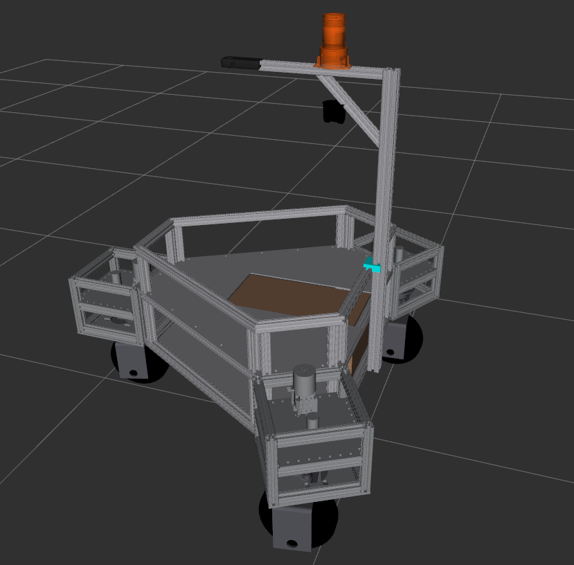
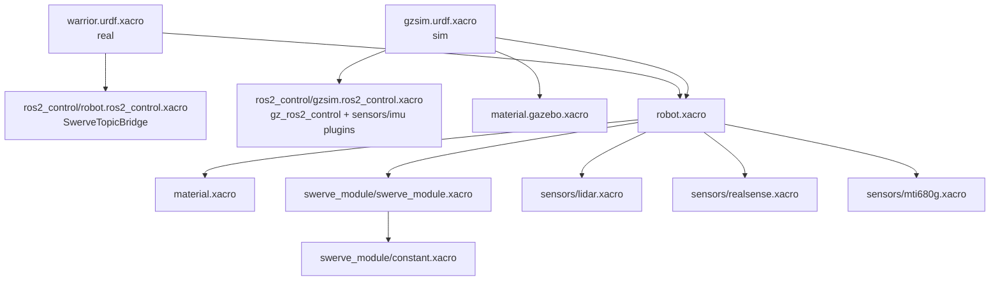

# warrior_description

URDF / xacro / meshes for the 2026 WSU Warrior swerve robot. See the
[workspace README](../README.md) for how this fits the stack.

## Quick start

```bash
pixi run build
pixi run ros2 launch warrior_description display.launch.py
```

<p align="center"></p>

## Two top-level descriptions

| URDF entry | Adds | Used by |
|---|---|---|
| [urdf/warrior.urdf.xacro](urdf/warrior.urdf.xacro) | **real** HW: `warrior_system/SwerveTopicBridge` ros2_control | real teleop / real launch |
| [urdf/gzsim.urdf.xacro](urdf/gzsim.urdf.xacro) | gazebo: `gz_ros2_control` + gz materials/sensors plugins | sim launches, `display.launch.py` |

Both include the shared body [xacro/robot.xacro](xacro/robot.xacro); they differ
only in the ros2_control layer + gazebo extras.

## Xacro include tree



> [xacro/inertial_macros.xacro](xacro/inertial_macros.xacro) (inertial_box /
> sphere / cylinder) and [xacro/diff_wheels.urdf.xacro](xacro/diff_wheels.urdf.xacro)
> exist but are **not** included by the swerve tree (legacy / diff-drive).

## robot.xacro structure

- `base_footprint` → `base_link` (warrior_body.stl) → `payload_link`, `pole_link`, `beacon_light_link`.
- 3× [swerve_module](xacro/swerve_module/swerve_module.xacro) via `xacro:swerve_module` macro at front / left / right plates (120° apart):
  - links: `${p}_slewing_plate_link` → `${p}_steer_assembly_link` → drive wheel.
  - joints: `${p}_steer_joint` (continuous, z-axis), `${p}_drive_joint` (continuous).
- LiDAR and beacon mount on `pole_link`; the RealSense mounts on `base_link` (see table below).

## Joints exposed to ros2_control

`{front,left,right}_steer_joint` (position) and `{front,left,right}_drive_joint`
(velocity) — must match `warrior_control` configs.

## Sensors (gazebo)

| Sensor | gz type | gz topic | frame |
|---|---|---|---|
| LiDAR | `gpu_lidar` | `L1_lidar/scan` | `L1_lidar_link` |
| RealSense D435 (RGB-D) | `rgbd_camera` | `camera/image`, `camera/depth_image`, `camera/points`, `camera/camera_info` → ROS `/camera/image_raw`, `/camera/depth/image_raw`, `/camera/points`, `/camera/camera_info` | `camera_color_optical_frame` |
| MTi-680G IMU | `imu` | `/mti680g/imu` | `imu_frame` |
| MTi-680G single GNSS antenna | `navsat` | `/mti680g/navsat` | `gnss_antenna_frame` |

The [MTi-680G profile](config/mti680g.yaml) configures mounting, rates, and the
measurement model. The native [MTi-680G adapter](../warrior_mti680g_sim/README.md)
publishes `/imu/data`, `/gnss/fix`, and `/gnss/velocity` with noise and covariance.
The body dimensions and mass match the MTi-680G; mounting offsets remain
provisional. `/odom_gt` remains available only for evaluation.

The [RealSense](xacro/sensors/realsense.xacro) replaced the Insta360
([camera.xacro](xacro/sensors/camera.xacro) is kept but no longer included).
It sits at the former Insta360 position, ~1.18 m above `base_footprint`,
pitched 25° down (`camera_xyz` / `camera_pitch` in
[robot.xacro](xacro/robot.xacro)) so the ground is visible from ~1.1 m ahead
for lane detection. Frames follow the `realsense2_camera` convention
(`camera_link`, `camera_{color,depth}_frame`, `camera_{color,depth}_optical_frame`).
Depth is rendered from the colour viewpoint, i.e. already colour-aligned.
Intrinsics (K and P) are set explicitly from `hfov`, because Fortress's
`rgbd_camera` otherwise publishes 320×240 defaults in `camera_info`.

Gazebo sensors render with **ogre2** (`sensor_render_engine`, see
[robot.xacro](xacro/robot.xacro)); ogre1 washes the aerial course texture
out to white. Under ogre2 the `gpu_lidar` would also render its own housing
mesh, whose inner faces sit inside `range.min` around the ray origin, and
drop those beams: a 25-50° blind wedge straight ahead. The housing visual is
therefore tagged `visibility_flags` 0x2 and the lidar's `visibility_mask`
excludes that bit ([lidar.xacro](xacro/sensors/lidar.xacro)); cameras still
see it.

Other gz↔ROS bridging is owned by `warrior_bringup` bridge yamls.
[config/gazebo_bridge.yaml](config/gazebo_bridge.yaml) (clock + `/odom`) is the
local copy.

## Meshes

[meshes/](meshes/) (STL): `warrior_body`, `slewing_plate`, `steer_assembly`,
`drive_wheel`, `payload`, `beacon_light`, `insta360_camera`, `unitree_lidar`.

## Launch / config

| File | Purpose |
|---|---|
| [launch/display.launch.py](launch/display.launch.py) | RSP + joint_state_publisher_gui + RViz; args `model`, `use_gui`, `rvizconfig` |
| [rviz/warrior_urdf.rviz](rviz/warrior_urdf.rviz) | display rviz config |

## Notes / staleness

- `gzsim.urdf.xacro` accepts `controllers_file`, defaulting to
  `$(find warrior_control)/config/warrior_controllers_sim.yaml`. GPS simulation
  uses this to disable controller TF while its local EKF owns that transform.
- [CMakeLists.txt](CMakeLists.txt) installs `launch urdf meshes xacro rviz config`.
  The live generic bridge yamls remain in `warrior_bringup`.
- `urdf/robot/*.urdf`, `urdf/warrior*.urdf`, `urdf/turtlebot3_burger_gps.urdf`
  are pre-generated / legacy static URDFs, not produced by the current xacro tree.
