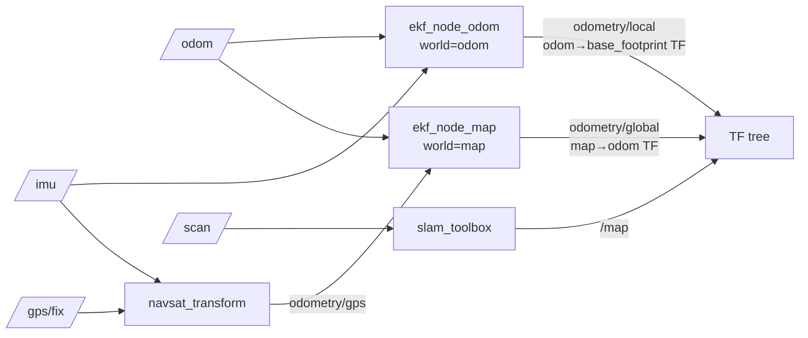

# warrior_localization

Sensor fusion + mapping. Wraps `robot_localization` (EKF + navsat) and
`slam_toolbox`. Outputs filtered odometry, the `map`→`odom`→`base_footprint` TF
chain, and (in SLAM) an occupancy map.

ament_python. Most work is config + launch over upstream nodes, with a GNSS
velocity frame adapter for navigation without encoders.

## Data flow



EKF runs in two modes: single (odom only) or **dual + navsat** (global GPS-fused).

## Nodes

- `gnss_velocity_to_body` converts ENU antenna velocity and IMU measurements
  into `/gnss/velocity_body` in `base_footprint`, including the antenna lever arm.
- `robot_localization` supplies both EKFs and navsat; `slam_toolbox` supplies mapping.
- The robot pose in the `map` frame is published directly by the localization
  node (the old `map_robot_pose` helper was removed).

## Launch — [launch/](launch/)

| File | Brings up | Notes |
|---|---|---|
| [ekf.launch.py](launch/ekf.launch.py) | one `ekf_node` (`ekf_node_odom`) → `/odometry/filtered` | local odom fusion only. `use_sim_time` arg (default `true`) |
| [dual_ekf_navsat.launch.py](launch/dual_ekf_navsat.launch.py) | `ekf_node_odom` (→`odometry/local`) + `ekf_node_map` (→`odometry/global`) + `navsat_transform` | full GPS-fused stack |
| [gps_sim.launch.py](launch/gps_sim.launch.py) | two EKFs + navsat using the simulated MTi-680G GNSS/INS; velocity adapter in encoder-free mode | `use_sim_time` (default `true`), `use_wheel_odometry` (default `true`), `params_file`; included by GPS simulation bringup |
| [online_async_launch.py](launch/online_async_launch.py) | `slam_toolbox/async_slam_toolbox_node` (lifecycle, autostarted) | SLAM mapping. Args: `autostart`, `use_lifecycle_manager`, `use_sim_time`, `slam_params_file` |

## Config — [config/](config/)

### [gps_sim_ekf.yaml](config/gps_sim_ekf.yaml)

Both GPS simulation modes use the MTi-680G interface: `/imu/data`
(`sensor_msgs/Imu`), `/gnss/fix` (`sensor_msgs/NavSatFix`), and `/gnss/velocity`
(`geometry_msgs/TwistWithCovarianceStamped`, ENU axes).

With `use_wheel_odometry:=true` (the default), the local filter fuses `/odom`
wheel velocities and IMU yaw rate into continuous `/odometry/local`.
With `use_wheel_odometry:=false`, both filters omit the wheel source entirely
and instead fuse the GNSS/INS linear velocity from `/gnss/velocity_body`.
This supplies measured forward and lateral velocities, including swerve motion;
it does not double-integrate accelerometer measurements. In both modes, the
global filter adds absolute IMU heading and `/odometry/gps` positions converted
from `/gnss/fix`.
The local filter owns `odom` → `base_footprint`, so the swerve controller's
`enable_odom_tf` must be `false` in this mode. The GPS bringup sets this override.

The `map` origin is initialized from the first GPS fix and filtered base pose;
its axes use east/north/up, independent of the robot's spawn heading. The
Gazebo IMU explicitly uses ENU orientation. `navsat_transform` accounts for UTM
grid convergence and serves `/fromLL` to convert each latitude/longitude
waypoint into that same `map` frame. The GPS antenna offset is read from TF.
Startup waits for `/odometry/gps` before sending goals.

No saved occupancy map, SLAM pose, or `/odom_gt` pose feeds these filters.
LiDAR remains an obstacle sensor for Nav2. The filters see only noisy simulated
sensor outputs. The simulation is an RTK-fixed nominal model, not a model of
all hardware bias, multipath, correction outages, or GNSS reacquisition behavior.

To run localization directly, with the simulator and robot TF already running:

```bash
ros2 launch warrior_localization gps_sim.launch.py use_wheel_odometry:=true
ros2 launch warrior_localization gps_sim.launch.py use_wheel_odometry:=false
```

`params_file` tunes the filters and adapter. In its source YAML, `odom0` is
reserved for wheel odometry in each EKF; the map filter's `odom1` is GNSS pose.
The launch helper removes wheel inputs and renumbers GNSS inputs in encoder-free
mode, even if `odom0` was remapped in a custom parameters file. `twist0` is
reserved for the converted GNSS velocity in that mode.

The velocity adapter expects antenna-point velocity in the `gnss_enu` basis,
with east/north/up axes, and attitude that rotates `imu_frame` into ENU
(zero yaw east). `gnss_enu` names a coordinate basis and needs no dynamic TF.
The IMU's static rotation into `base_footprint` is applied before converting
velocity, so no EKF output is required at startup. Static TF from the base to
`gnss_antenna_frame` supplies the antenna lever arm: the adapter subtracts
`angular_velocity × antenna_offset` to recover base velocity during turns.
Hardware drivers must use matching ENU conventions and report velocity at the
antenna point, or supply a zero lever arm if their velocity is already corrected
to the robot reference point. Antenna and IMU mount parameters must match TF.

Velocity covariance is rotated and augmented with attitude and gyro uncertainty.
The propagation assumes those errors are independent; it does not model internal
MTi filter correlations. The adapter uses the nearest buffered IMU sample and
drops velocity if no sample is within `max_imu_age` (default 0.2 s), if the
velocity timestamp differs from ROS time by more than `max_velocity_age`
(0.5 s), or if sensor covariance/orientation is invalid. IMU timestamps must
share the GNSS clock. It does not interpolate attitude. Missing sensor data is
not replaced with ground truth: EKFs continue prediction, with drift during
outages, so encoder-free operation requires usable GNSS/INS velocity updates.

### [ekf_config.yaml](config/ekf_config.yaml)
- `ekf_node_odom`: `world_frame=odom`, fuses `odom0=/odom` + `imu0=/imu`, `two_d_mode`, 30 Hz, `publish_tf`.
- `ekf_node_map`: `world_frame=map`, adds `odom1=/odometry/gps`.
- `navsat_transform`: `gps/fix`+`imu`+`odometry/global` → `odometry/gps`; `magnetic_declination_radians=0`, `zero_altitude`, `publish_filtered_gps`, `wait_for_datum=false`.

### [mapper_params_online_async.yaml](config/mapper_params_online_async.yaml)
- slam_toolbox: `mode: mapping` (toggle to `localization`), `scan_topic=/scan`, frames `map`/`odom`/`base_footprint`, `resolution 0.05`.

## Frames

`map` → `odom` (ekf_node_map / slam_toolbox) → `base_footprint` (ekf_node_odom).
Run only **one** map-frame TF publisher at a time (dual-EKF **or** SLAM, not both).

## Notes
- `package.xml` description/maintainer/license are TODO placeholders.
