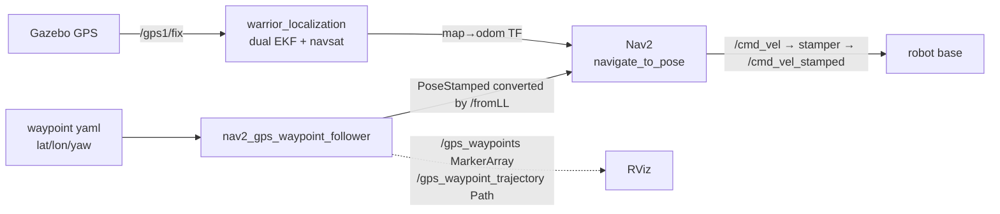

# warrior_navigation

Path planning + GPS waypoint following. The current stacks are:

1. **Odom-relative Nav2 simulation** — a mapless rolling costmap profile for
   the Warrior Gazebo model.
2. **GPS Nav2** — Nav2 bringup + a thin GPS waypoint follower.
3. **Custom A\*** — in-package planner / recovery / pure-pursuit controller
   (`compute_path_to_pose` + `recovery_manager` + `follow_path`).

ament_python. Heavily simulation-oriented (TurtleBot3 Gazebo) — see [Staleness](#staleness).

## Warrior Nav2 simulation

From the workspace root:

```bash
pixi run --locked launch-nav-sim
```

RViz opens after Nav2 is active and `/navigate_to_pose` is ready. Its Warrior
profile starts in an Orbit/3D view with the robot, lidar cloud, costmap, and
planned path. Use the toolbar's **Nav2 Goal** tool, or send a goal in the
`odom` frame:

```bash
pixi run --locked ros2 action send_goal \
  /navigate_to_pose nav2_msgs/action/NavigateToPose \
  "{pose: {header: {frame_id: odom}, pose: {position: {x: 2.0, y: 0.0, z: 0.0}, orientation: {w: 1.0}}}}" \
  --feedback
```

This profile uses `/scan`, rolling local and global costmaps, and wheel
odometry. Regulated Pure Pursuit uses forward/yaw motion for predictable Humble
simulation behavior; the base remains holonomic during manual teleoperation.
The profile has no map, AMCL, GPS correction, or persistent world frame, so a
goal is relative to the startup pose and accumulated odometry can drift. Do not
run a teleop publisher at the same time: the stack has no command mux yet. No
**2D Pose Estimate** is needed for this odom-relative profile.

## Nav2 GPS waypoint flow

For the current Warrior model, use `pixi run --locked launch-gps-sim`; see the
[GPS simulation guide](../warrior_bringup/README.md#gps-waypoints-through-an-open-area).
This uses `nav2_gps_sim_params.yaml` and the same `waypoints` list of
`latitude`, `longitude`, and `yaw` fields as `demo_waypoints.yaml`. Yaw is
radians counterclockwise from east. The default
`igvc2027_no_mans_land_waypoints.yaml` matches the separate schematic training
world; it contains simulated coordinates, not official surveyed waypoints.
`no_mans_land_waypoints.yaml` is a smoke route in the older `competition.world`.
Both use its Oakland datum; the California coordinates in `demo_waypoints.yaml`
do not match these worlds.

The new simulation passes `conversion_mode:=from_ll` to the follower. It waits
for navsat odometry and converts every waypoint through `/fromLL` before
starting. `intermediate_goal_distance:=20.0` splits far destinations using the
current TF pose; only reaching the final destination advances the GPS waypoint
index. Any rejected, canceled, or aborted goal stops the mission with an error.
The GPS launch also supplies `costmap_topic:=/global_costmap/costmap` so an
intermediate endpoint inside a known inflated obstacle is shortened before
dispatch. The actual GPS destination stays fixed. Other callers can opt into
this check using a Nav2 OccupancyGrid topic in the same global frame.
`/gps_waypoints` and `/gps_waypoint_trajectory` retain their latest visualization
for RViz. YAML is validated as a complete mission rather than skipping bad rows.

Legacy launches default to `conversion_mode:=projection`, with an automatic
UTM zone and the first waypoint as origin unless `map_origin_latitude` and
`map_origin_longitude` are explicitly set. This fallback is only valid when
that origin matches the localization frame. Set `map_origin_yaw` to that
frame's heading and `intermediate_goal_distance` to a suitable positive value
when using a rolling global map. The new GPS simulation avoids this manual
origin configuration by using `/fromLL`.

For the complete P37 environment and its generated four-target mission, use
`pixi run --locked launch-igvc2027-gazebo` or
`pixi run --locked launch-igvc2027-isaac`; see the
[2027 course guide](../warrior_simulation/igvc2027/README.md).

Both simulators use `ground_filter.py` to estimate the nearby road plane and
follow gradual curvature using radial profiles of low lidar returns.
Gazebo's `ground_obstacle_scan` node first applies the full
sensor mounting transform and projects the retained obstacle returns into
`/navigation/scan`; Isaac calls the same filter on its raycast returns.
The plane estimate uses no simulator pose or DEM. It falls back to the nominal
ground height when the measured support is insufficient. Beyond 5 m, an extra
2.5 cm per metre (capped at 25 cm) allows gentle road curvature; small distant
obstacles may only become detectable as the robot approaches. This is an
obstacle filter for the GPS test, not a lane, pothole or general terrain classifier.



## Launch — [launch/](launch/)

| File | Stack | Notes |
|---|---|---|
| [swerve_nav_sim.launch.py](../warrior_bringup/launch_wrappers/swerve_nav_sim.launch.py) | **Nav2** | Recommended Warrior simulation entry point; base simulation + Twist stamper + odom-relative Nav2 + RViz. |
| [swerve_gps_nav_sim.launch.py](../warrior_bringup/launch_wrappers/swerve_gps_nav_sim.launch.py) | **Nav2 GPS** | Four-waypoint 2027 schematic simulation, fused localization, filtered lidar, and GPS mission. |
| [nav.launch.py](launch/nav.launch.py) | **Nav2** | Main entry. EKF + SLAM + `nav2_bringup` + `nav2_gps_waypoint_follower`. Defaults to `real_waypoints.yaml`, map origin args (lat/lon/yaw, UTM zone/hemisphere). |
| [nav2_gps_waypoint_follower.launch.py](launch/nav2_gps_waypoint_follower.launch.py) | **Nav2** | Gazebo + EKF + SLAM + nav2_bringup + follower. |
| [gps_waypoint_follower.launch.py](launch/gps_waypoint_follower.launch.py) | **custom A\*** | Gazebo + EKF + SLAM + costmap + `path_to_pose_server` + `recovery_manager` + `follow_path` + `gps_waypoint_manager`. |
| [complex_path.launch.py](launch/complex_path.launch.py) | **custom A\*** | Gazebo + EKF + SLAM + costmap + RViz + planner/recovery/follow_path. |
| [nav2_complex_path.launch.py](launch/nav2_complex_path.launch.py) | **Nav2** | Gazebo + EKF + SLAM + nav2_bringup + RViz. |
| [costmap.launch.py](launch/costmap.launch.py) | shared | Standalone global+local `nav2_costmap_2d` + lifecycle manager. |
| [turtlebot3_world_gps.launch.py](launch/turtlebot3_world_gps.launch.py) | sim | TurtleBot3 Gazebo world + spawn. ⚠️ sim-only. |
| [spawn_turtlebot3_gps.launch.py](launch/spawn_turtlebot3_gps.launch.py) | sim | Spawn TB3 burger + gz bridges. ⚠️ sim-only. |

After `pixi run --locked build`, run ROS commands inside `pixi shell`:

```bash
ros2 launch warrior_navigation nav.launch.py use_sim:=false waypoint_file:=<path>
```

## Nodes — [warrior_navigation/](warrior_navigation/)

| Executable | Source | Role |
|---|---|---|
| `nav2_gps_waypoint_follower` | [nav2_gps_waypoint_follower.py](warrior_navigation/nav2_gps_waypoint_follower.py) | Reads yaml waypoints, sends `NavigateToPose` goals to Nav2; pubs RViz markers/trajectory. |
| `waypoint_follower` | [logged_waypoint_follower.py](warrior_navigation/logged_waypoint_follower.py) | `nav2_simple_commander` `followGpsWaypoints` (BasicNavigator, localizer `robot_localization`). |
| `gps_waypoint_manager` | [gps_waypoint_manager.py](warrior_navigation/gps_waypoint_manager.py) | Custom-stack waypoint mgr; `ComputePathToPose` action **client**; pubs markers/trajectory. |
| `path_to_pose_server` | [compute_path_to_pose.py](warrior_navigation/compute_path_to_pose.py) | A\* planner. `ComputePathToPose` action **server**; subs `/costmap`, pubs `/a_star_path`. |
| `recovery_manager` | [recovery_manager.py](warrior_navigation/recovery_manager.py) | Wraps planner with recovery (clear costmap, replan); `ComputePathToPose` server+client. |
| `follow_path` | [follow_path.py](warrior_navigation/follow_path.py) | Pure-pursuit-style path tracker; subs `a_star_path`, pubs `/cmd_vel_stamped` (TwistStamped by default). |

Shared helper: [utils/gps_utils.py](utils/gps_utils.py) (`latLonYaw2Geopose`, quaternion conv).

### Key topics / actions
- `/a_star_path` (Path) — planner output → `follow_path`.
- `/costmap` (OccupancyGrid) — planner input.
- `/cmd_vel_stamped` (TwistStamped) — `follow_path` and swerve-controller command topic.
- `/cmd_vel` (Twist) — Nav2 controller output; converted to `/cmd_vel_stamped` by the simulation launch.
- `/gps_waypoints` (MarkerArray), `/gps_waypoint_trajectory` (Path) — RViz viz.
- `ComputePathToPose`, `NavigateToPose` — Nav2 actions.

## Config — [config/](config/)

| File | Purpose |
|---|---|
| [nav2_sim_params.yaml](config/nav2_sim_params.yaml) | Mapless, odom-relative Warrior simulation profile. |
| [nav2_gps_sim_params.yaml](config/nav2_gps_sim_params.yaml) | Mapless GPS profile using filtered lidar and intermediate goals. |
| [igvc2027_no_mans_land_waypoints.yaml](config/igvc2027_no_mans_land_waypoints.yaml) | Simulated GPS targets for the separate 2027 schematic approximation. |
| [nav2_params.yaml](config/nav2_params.yaml) | Nav2 bringup params. |
| [costmaps_only.yaml](config/costmaps_only.yaml) | Standalone costmap params (costmap.launch.py). |
| [real_waypoints.yaml](config/real_waypoints.yaml) | **Real-robot** GPS waypoints (default for `nav.launch.py`). |
| [practice_waypoints.yaml](config/practice_waypoints.yaml) | Practice-field waypoints. |
| [demo_waypoints.yaml](config/demo_waypoints.yaml) | Demo waypoints. |
| [turtlebot_sim_waypoints.yaml](config/turtlebot_sim_waypoints.yaml) | TB3 Gazebo waypoints. |
| [turtlebot3_burger_gps_bridge.yaml](config/turtlebot3_burger_gps_bridge.yaml) | gz↔ROS bridge for sim. |
| [maps/gz_world_save.yaml](maps/gz_world_save.yaml) | Saved Gazebo-world occupancy map. |

**Waypoint yaml format:**
```yaml
waypoints:
  - {latitude: 42.668212, longitude: -83.218459, yaw: 0.0}
```

## Staleness

- **Broken `console_scripts`** in [setup.py](setup.py): `direct_path_generator`,
  `map_robot_pose`, `linear_path_controller`, `astar_planner` — **no source files
  exist**; `colcon build` installs them but they fail to run.
- [logged_waypoint_follower.py](warrior_navigation/logged_waypoint_follower.py)
  imports `warrior_navigation.gps_utils`, but `gps_utils.py` lives under
  [utils/](utils/) — relies on the install layout flattening it; fragile.
- TurtleBot3 launch files (`turtlebot3_world_gps`, `spawn_turtlebot3_gps`,
  `*complex_path`) are **simulation-only** and need the TB3 Gazebo packages.
- `package.xml` description/maintainer/license are TODO placeholders.
