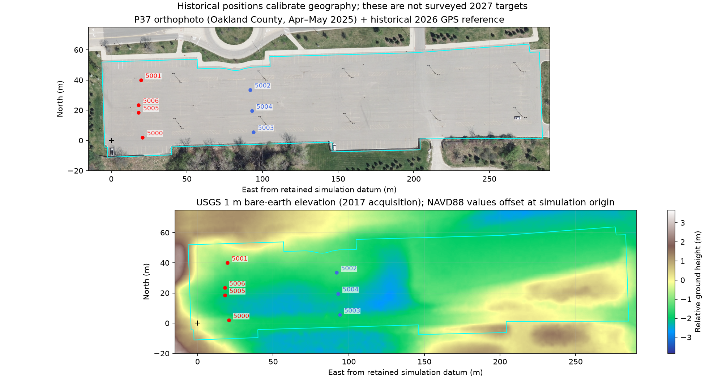
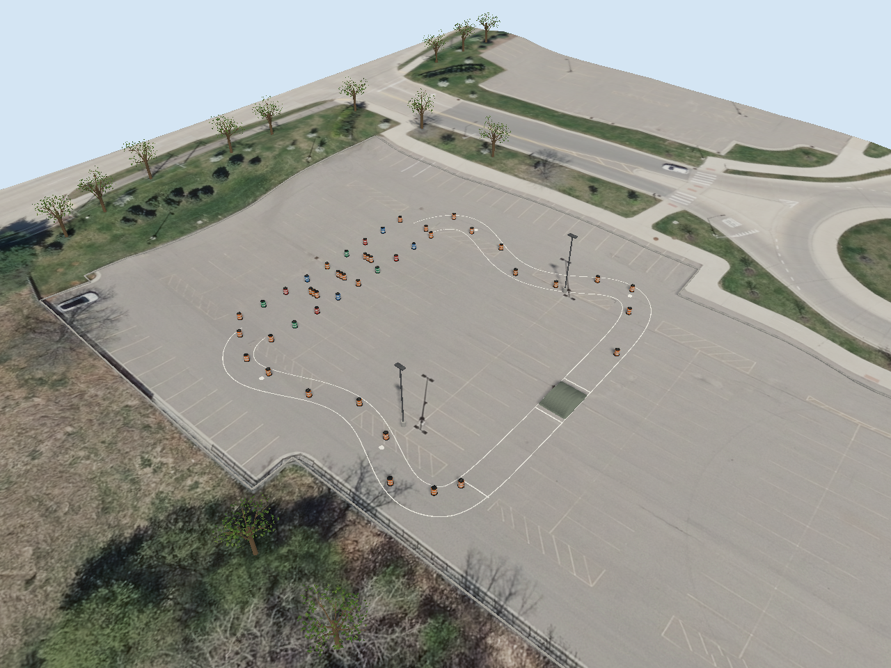
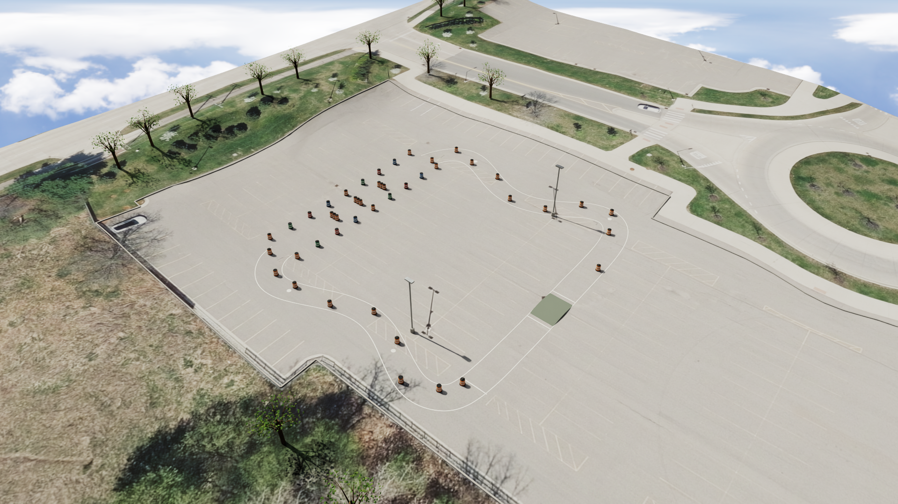
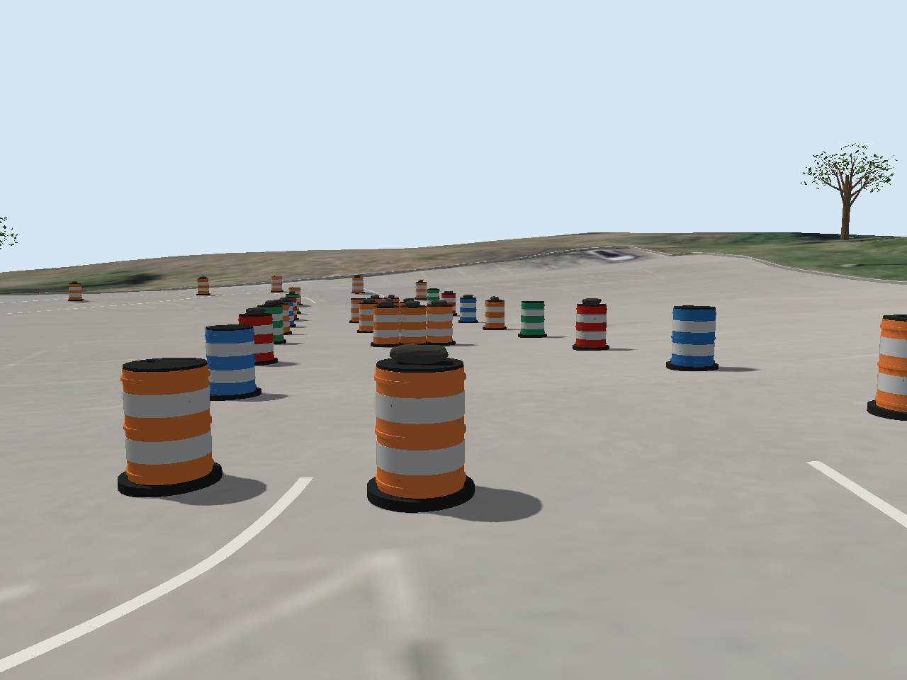
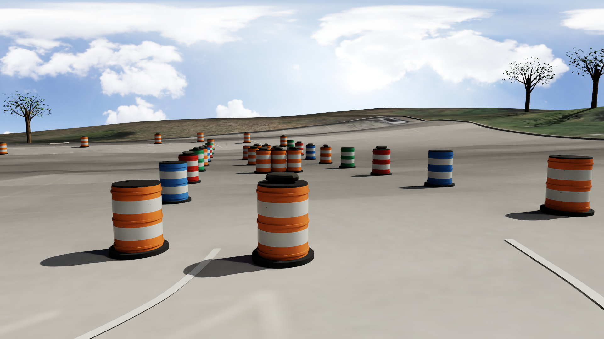

# IGVC 2027 AutoNav simulation

The full AutoNav environment is generated for **Gazebo Fortress** and **Isaac
Sim 5.1** from one [course definition](course.yaml). It includes the west
no-man's-land section, four GPS targets, both winding taped runs, the east
start/finish straight and ramp, speed-check gates, drums, potholes, and the
surrounding P37 parking surface. Coordinates are metres, east/north/up.

The 2027 course follows the official schematic, geographically registered
using the organizer's historical 2026 GPS points. The site uses actual 2025
orthophotography and measured terrain elevation. The 2027 obstacle arrangement
and targets remain a simulation reconstruction; no final surveyed 2027 course
coordinates have been published in the reviewed sources.

## Run

From the repository root:

```bash
# Build ROS packages, spawn Warrior at the north entrance of no-man's-land,
# start GPS + IMU + wheel-odometry fusion, and drive the four GPS targets.
pixi run launch-igvc2027-gazebo

# Run the robot and GPS mission in the installed Isaac Sim.
pixi run launch-igvc2027-isaac

# Inspect the Isaac environment without starting the robot mission.
pixi run inspect-igvc2027-isaac
```

For Gazebo options after the build:

```bash
pixi run ros2 launch warrior_bringup igvc2027_autonav.launch.py \
  launch_gui:=false launch_rviz:=false

# Inspect the scene without starting the waypoint mission:
pixi run ros2 launch warrior_bringup igvc2027_autonav.launch.py \
  autostart_waypoints:=false
```

Isaac defaults to `$HOME/isaacsim`; set `ISAAC_SIM_PATH` for another installation.
Its stage contains the environment, physics, cameras and `/World/RobotSpawn`.
The launch task runs Warrior with the ROS navigation and sensor integration;
the inspect task opens the environment alone. See the
[Isaac guide](../warrior_isaac/README.md) for sensor details, headless runs and
captures.

The GPS mission uses the same `waypoints` YAML schema as `demo_waypoints.yaml`:

- [Four no-man's-land targets](../../warrior_navigation/config/igvc2027_autonav_nml_waypoints.yaml)
- [Two-target long-leg diagnostic](../../warrior_navigation/config/igvc2027_autonav_long_leg.yaml)
- [Generated spawn profile](../../warrior_navigation/config/igvc2027_autonav_sim.yaml)
- [Full-lap reference targets](../../warrior_navigation/config/igvc2027_autonav_reference_lap.yaml)

The full-lap file records the nominal centerline for diagnostics. Lidar cannot
recognize flat white tape or pothole disks, so GPS plus lidar alone does not
provide full AutoNav lane and pothole compliance. The launch runs the four
no-man's-land targets. See the [navigation setup](../../warrior_bringup/README.md#gps-waypoints-through-an-open-area)
for the filtered obstacle scan, two EKFs and rolling costmaps.

Both simulators use the same ground filter. It applies the complete lidar
mounting transform, estimates a nearby road plane from measured returns,
then follows low returns outward in 36 angular sectors and 0.5 m distance
bins. This handles the parking lot's shallow depressions without reading the
DEM or simulated robot position. Nearby objects must exceed 0.15 m above the
estimated road; the threshold rises to 0.40 m at 15 m range. Low or sparsely
sampled obstacles can therefore be missed, and the filter does not detect
drop-offs or provide a general traversability guarantee.

To test a goal beyond the 15 m lidar range, use the diagnostic mission after
building the packages:

```bash
pixi run ros2 launch warrior_bringup igvc2027_autonav.launch.py \
  waypoint_file:="$(pwd)/warrior_navigation/config/igvc2027_autonav_long_leg.yaml"
```

This mission visits the first and last no-man's-land markers, separated by
about **30.63 m**. The follower retains the final GPS target while selecting
intermediate goals inside the rolling costmap. This specifically tests travel
beyond the current lidar footprint; the default mission still visits all four
markers.

## Geographic placement and dimensions

The venue is Oakland University's **P37**, checked against the organizer's
event information, the university campus map, and the parking outline from
OpenStreetMap. The existing Gazebo datum is retained:
**42.667910° N, 83.219580° W**, elevation **286 m**. The elevation remains an
inherited ellipsoid reference for simulation, not a parking-lot survey.
Generated course props are checked against the mapped parking polygon.

The organizer's [2026 AutoNav coordinate image](https://gl-systems-technology.net/uploads/3/4/7/2/34727963/2026-igvc-gps-waypoints-2_orig.jpg)
lists four main and three practice points. Its numbers use an inferred
**packed degrees/minutes/seconds** interpretation: `42.400577100` becomes
42° 40′ 05.77100″ N, or **42.668269722222°**. The longitude
`-83.130962509` becomes 83° 13′ 09.62509″ W, or **−83.219340302778°**.
Treating these strings as decimal degrees or NMEA `DDMM.MMMM` places the
points outside the venue. All seven decoded positions agree with P37's
mapped footprint. The image does not explicitly state its encoding, datum,
or accuracy; WGS84 is an assumption for this reconstruction.

[The transcribed reference data](reference/igvc2026_waypoints_reference.json)
retains the original strings and conversion details. The four main points
have ENU centroid **(19.107762, 20.960325) m**. Their south-to-north endpoint
bearing establishes a **1.565038° counterclockwise rotation from ENU north**.
The compiler aligns the 2027 schematic's no-man's-land markers with that
historical axis and centroid by translation and rotation. It preserves the
500 ft loop scale and the relative 2027 marker arrangement; it does not
substitute the 2026 targets for the 2027 targets or rescale the loop to fit
historical waypoint spacing. Exact placement is recorded in `course.yaml`
and `scene.json`.

Coordinate precision preserves consistency between simulators; it does not
establish centimetre positioning accuracy. The 2026 reference gives useful
geographic alignment but cannot establish the 2027 event's final allocation
or obstacle positions. Replace the reconstruction when surveyed 2027 data
becomes available.

| Property | Simulation value |
| --- | --- |
| Nominal centerline length | 152.4 m / 500 ft |
| Lane width | 3.66 m |
| Tape width | 0.1016 m / 4 in |
| Speed-check straight | 13.4112 m / 44 ft |
| Ramp | 0.20 m rise over 2 m run; 10% added grade over measured terrain |
| Pothole disk diameter | 0.6096 m / 2 ft |
| Lane envelope | Reported in `scene.json` after registration |

The official rules give an approximate 120 × 100 ft area (36.576 × 30.48 m).
This reconstruction scales the illustrated loop to 500 ft; its envelope is
larger than that nominal area. It is therefore a training approximation, not
evidence of compliance with every competition dimension. Exact generated
bounds, geometry and measurements are recorded in [scene.json](scene.json).
The ramp's nominal rise is measured relative to the local ground. Its actual
sloping surfaces include the DEM grade and are tested against the 15% limit.

## Site imagery, terrain and appearance

The site reference is [Oakland County's 2025 orthophotography](reference/p37_oakland_2025.png),
captured April 27–May 12, 2025, at a native 0.25 ft / **7.62 cm** resolution.
The supplied crop has a documented EPSG:3857 extent. It contains the actual
parking stripes, pavement cracks, curbs, grass and tree groups rather than
a repeated asphalt texture. An independent public-domain USDA/USGS
[2022 NAIP image](reference/p37_naip_2022.png) provides leaf-on context.
Neither aerial depicts the 2027 competition obstacles.

[USGS 3DEP bare-earth elevation](reference/p37_elevation_grid.json) supplies
the site's broad grade and surrounding relief. Its Oakland County source
has **1 m native resolution**, acquisition dates March 29–May 3, 2017, and
**NAVD88 orthometric heights**. The raster is resampled into the documented
EPSG:3857 grid. Export pixel spacing does not increase its native accuracy.
The local simulation height subtracts **272.143718 m**, the bilinearly
sampled elevation at the retained origin. This relative-height offset keeps
the existing 286 m ellipsoid anchor; it is not a NAVD88-to-ellipsoid geoid
conversion. No artificial bumps are added to represent missing survey data.



The imagery guides the location of site features. Tree height and canopy
shape, lamp height, curb cross-sections and small vertical details remain
inferred geometry. A 1 m bare-earth DEM cannot resolve precise curb faces,
individual asphalt defects or current surface changes. The result is a
reference-based 3D environment, not a photogrammetric mesh of the venue.
Historical competition photographs and video guide drums, reflective bands,
sandbags, white tape and ramp details. The optional Poly Haven midday HDRI
provides generic outdoor illumination; it is not a record of Oakland weather.

Actual simulator captures:

| Gazebo | Isaac Sim RTX |
| --- | --- |
|  |  |
|  |  |

[Reference provenance](reference/sources.json) records URLs, inspected pages,
dates, coordinate confidence and reuse notes. It includes the official
[2027 rules](https://www.gl-systems-technology.net/uploads/3/4/7/2/34727963/igvc_2027_rules_version_7_july_26.pdf),
[2025 Bridgeport report](https://igvc.secs.oakland.edu/design/2025/6.pdf),
the organizer's video links, and the user's local `/home/lab2005/projects/igvc`
research archive. The inspected organizer-linked chicane clip has 2023 file
metadata and is labeled historical, separately from the 2025 photo references.
Competition photographs and footage are not redistributed. The bundled
county aerial is reusable under the [Oakland County Open Data terms](https://www.oakgov.com/open-data-terms),
with attribution to **Oakland County, Michigan**, and imagery production by
**Sanborn Map Company**. NAIP and 3DEP data are public domain, attributed to
**USDA, USGS and The National Map**. The daylight HDRI by **Greg Zaal and
Jarod Guest, Poly Haven**, is [CC0](https://polyhaven.com/license).

Parking-boundary data: **© OpenStreetMap contributors**, [way 43097152](https://www.openstreetmap.org/way/43097152),
available under [ODbL 1.0](https://opendatacommons.org/licenses/odbl/1-0/).
The attributed source is preserved in [p37_boundary.geojson](reference/p37_boundary.geojson).

## Edit and validate

Edit `course.yaml`, then regenerate both worlds, meshes, spawn profile and
waypoint files together:

```bash
pixi run build-igvc2027-course
pixi run python -m pytest warrior_simulation/igvc2027/test warrior_navigation/test
bash warrior_simulation/warrior_isaac/validate_stage.sh \
  --scene warrior_simulation/igvc2027/scene.json
pixi run ign sdf -k warrior_simulation/warrior_gazebo/worlds/igvc2027_autonav.world
```

Rebuild ROS packages after regeneration to refresh installed assets. Isaac's
stage references the shared texture directory, so keep `igvc2027/` and
`warrior_isaac/` together. Generated files are checked in so launching does not
require a source-image download or an exporter run.

Validation on **2026-11-01** used the final 942-object scene with the measured
terrain and actual aerial texture. All **63 focused tests** passed, 15 ROS
packages built, and regeneration reproduced 440 generated artifacts byte for
byte. Independent geometry checks confirmed that the surrounding terrain has
one parking-lot hole and zero overlap with the asphalt. Paint, waypoint
altitudes and spawn clearance were checked against the actual collision mesh.

| Runtime check | Result |
| --- | --- |
| Gazebo Fortress 6.16.0, default mission | 4/4 GPS targets, 4 successful navigation legs |
| Gazebo, 30.63 m diagnostic | 2/2 GPS targets, including a 20 m intermediate goal; 3 successful navigation legs |
| Isaac Sim 5.1.0, native GUI mission | 4/4 GPS targets; 155 s bounded run with physical lidar, IMU and wheel odometry |
| Isaac command-loss test | Stale/nonfinite packets rejected; 6.47 mm residual position drift in the bounded test |

Gazebo menu, camera-follow and zoom controls were exercised with the robot and
RViz running. Isaac rendered and drove the robot on an RTX 5090; its distant
two-target diagnostic was not separately repeated. The shared follower's
travel beyond the 15 m lidar range was demonstrated by the Gazebo diagnostic.
All test processes were stopped afterward.

[Validation evidence](validation.json) records scene/world/stage hashes,
commands, timings, log excerpts, sensor reports and the scope of each check.
These simulation results do not establish real GPS noise, wheel slip, physical
sensor calibration or outdoor localization accuracy.
